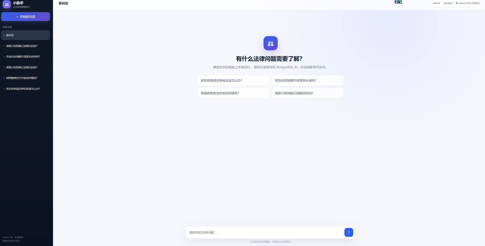
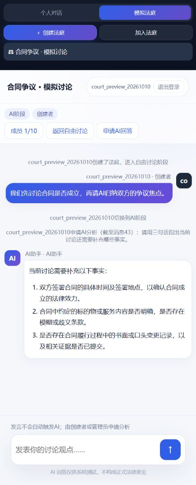
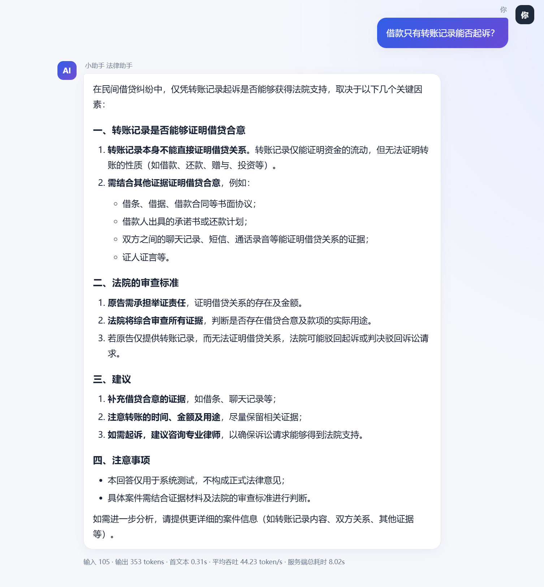
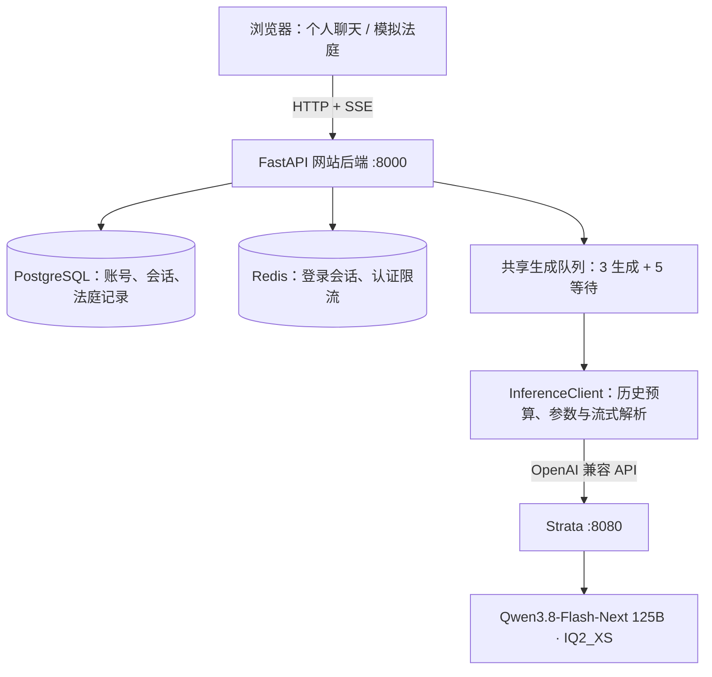

# Qwen 125B · 多人模拟法庭与法律问答

基于 **Qwen3.8-Flash-Next 125B（IQ2_XS 量化）** 的本地法律问答与多人模拟法庭平台。通过 Strata 提供模型推理，支持个人连续对话、多人角色协作、共享法庭讨论和 AI 争议分析。

模型在本机运行；账号、个人会话和法庭记录使用 PostgreSQL 持久化保存。网站后端通过 OpenAI 兼容 HTTP API 调用模型，不需要在 Web 进程中加载权重。

> 用于教学讨论和系统实验，模型回答不构成正式法律意见。本仓库包含应用代码，不包含模型权重、真实聊天数据、数据库文件或部署密钥。

## 功能亮点

### 多人模拟法庭

- 创建法庭，通过邀请码加入，每个房间最多 10 人。
- 支持法官、管理员、原告、被告、旁听者及待分配身份，按角色控制操作权限。
- 自由讨论与 AI 阶段切换，成员发言通过 SSE 实时同步。
- 法官或管理员发起 AI 分析，结合申请前的讨论梳理争议、总结观点、指出待核实材料。
- 模型输入保留发言人和角色，区分各方主张与已确认事实；生成期间的新发言留给下次分析。
- 房间消息和 AI 最终回答持久化保存。

### 个人法律问答

- 注册、登录、账号隔离、个人会话管理与历史记录。
- 流式输出，Markdown 渲染与 HTML 清理。
- 历史不再固定为 20 条，而是按实际 token 预算保留最近的完整问答轮次。
- 输入框附近可切换关闭 / 低 / 中 / 高思考模式，下一次请求生效，无需重新加载模型。
- 回答多样性支持四档：`0.2 / 0.4 / 0.7 / 1.0`。
- 思考内容以小字临时流式显示，最终回答开始输出后隐藏；历史只保存最终答案。

### 推理与调度

- 默认连接 Strata，也保留 vLLM / Qwen3-8B 配置入口。
- 默认输入预算 **32,768 token**，输出上限 **2,048 token**；思考也计入输出预算。
- Strata 模式网站默认 **3 个生成名额 + 5 个等待位置**，个人聊天和法庭 AI 共用队列。
- 每个账号最多占用一个活动或排队请求；支持排队提示、断线释放和超时处理。
- 低 / 中 / 高思考预算分别为 256 / 512 / 1024 token。

## 系统界面

以下截图用于展示交互设计。首页及回答示例来自早期 Qwen3-8B 版本，模型标签和设置入口可能与当前版本不同；当前默认模型为 Strata 提供的 125B IQ2_XS。

### 个人对话首页



### 多人模拟法庭



### 法律问答示例



## 系统架构



Strata 与 vLLM 都是独立推理服务。本应用负责账号、权限、上下文和界面；模型加载、GPU / CPU 协同与专家缓存由 Strata 负责。

## 快速开始

### 1. 准备环境与模型服务

- Python 3.11（项目开发环境）、Docker Desktop 或其他支持 Compose 的 Docker 环境。
- 先单独安装并运行 [Strata](https://github.com/Niko1221/Strata)，加载 IQ2_XS 模型。
- 本项目已在 RTX 4090 24GB、约 64GB 内存的 Windows 环境验证；其他配置请按 Strata 的硬件说明评估。
- 本项目不会自动下载模型，也不包含 Strata 引擎。

确认模型就绪：

```powershell
Invoke-RestMethod http://127.0.0.1:8080/health
```

应返回 `status: ok` 且 `loaded: true`。首次接入建议使用 Strata 的单槽配置验证，再将引擎 `parallel` 与网站 `GENERATION_SLOTS` 同步调整，避免只有网站放行、引擎实际排队。

### 2. 获取项目与安装依赖

```powershell
git clone https://github.com/upczss/qwen-125b-courtroom.git
cd qwen-125b-courtroom\qwen-local
python -m venv .venv
.\.venv\Scripts\Activate.ps1
python -m pip install -r requirements-web.txt
```

### 3. 启动数据库

```powershell
Copy-Item deploy/local/.env.example deploy/local/.env
```

编辑 `deploy/local/.env`，将示例密码替换为自己的随机密码，再执行：

```powershell
docker compose -f deploy/local/compose.yaml up -d --wait
python -m alembic upgrade head
```

PostgreSQL 和 Redis 使用 Docker 持久化数据卷；`.env` 不会提交到仓库。应用读取该文件中的 `POSTGRES_PASSWORD`，也支持独立设置 `DATABASE_URL`。

### 4. 启动本地网站

```powershell
$env:INFERENCE_PROVIDER = 'strata'
$env:INFERENCE_BASE_URL = 'http://127.0.0.1:8080'
$env:INFERENCE_MODEL = 'strata'
# Strata 只有一个实际槽位时先填 1；本机配置 parallel=3 后可填 3。
$env:GENERATION_SLOTS = '1'
python serve_vllm.py
```

浏览器访问 **http://127.0.0.1:8000/**，注册并登录。

`serve_vllm.py` 为沿用的入口名称，目前默认调用 Strata，不会启动 vLLM 或在网站进程内加载模型。使用该入口即可体验思考切换、历史与法庭功能。

## 常用配置

环境变量需在启动网站的终端中设置；修改后重启网站后端。思考模式和多样性由前端逐请求传递，无需重启。

| 环境变量 | Strata 模式默认值 | 说明 |
|---|---|---|
| `INFERENCE_PROVIDER` | `strata` | 可选 `strata` / `vllm` |
| `INFERENCE_BASE_URL` | `http://127.0.0.1:8080` | 接受带或不带 `/v1` 的地址 |
| `INFERENCE_MODEL` | `strata` | API 请求中的模型名 |
| `INFERENCE_API_KEY` | `none` | Strata 开启认证时填写对应密钥 |
| `INFERENCE_MAX_INPUT_TOKENS` | `32768` | 系统提示、历史与当前问题的总输入预算 |
| `INFERENCE_MAX_NEW_TOKENS` | `2048` | 思考与最终回答共用输出上限 |
| `GENERATION_SLOTS` | `3` | 不应超过引擎实际并发槽位 |
| `GENERATION_QUEUE_SIZE` | `5` | 等待队列容量 |
| `DATABASE_URL` | 本地 PostgreSQL 配置 | 可覆盖数据库连接 |
| `REDIS_URL` | `redis://127.0.0.1:6379/0` | 认证会话与限流 |

输入与输出预算之和不能超过 Strata 实际上下文上限。法庭记录按完整发言裁剪，个人历史按完整轮次裁剪；裁剪不会删除原始数据库记录。目前尚未实现历史摘要或长期语义记忆。

## 公网部署与关闭

项目提供 `serve_public.py`，用于已有 HTTPS 隧道部署，和本地入口二选一。该脚本目前预设作者的域名，其他部署者需要修改其中的 `ALLOWED_ORIGINS` 为自己的 HTTPS 域名，并将隧道转发至本地 `8000`。不要将 Strata 的 `8080` 直接作为网站入口。

数据库、Redis 和 Strata 就绪后，运行 `python serve_public.py`，并启动自己的隧道客户端。公网模式设置 Secure Cookie，请通过 HTTPS 域名登录。详见 [公网部署说明](qwen-local/PUBLIC_ACCESS.md)。

关闭时先等待回答结束，再停止隧道和网站进程，最后关闭 Strata、停止基础设施：

```powershell
docker compose -f deploy/local/compose.yaml stop
```

日常关闭不要执行 `down -v`，它会删除数据库数据卷。公网使用时请求和回答会经过隧道提供方中转。

## 代码导航

```text
README.md
docs/images/                         已审核的展示截图
qwen-local/
├── backend/
│   ├── main.py                      个人会话、消息和 SSE 接口
│   ├── courts.py                    法庭角色、阶段、讨论与共享 AI
│   ├── inference_client.py          Strata / vLLM API、token 预算、流式事件
│   ├── generation_settings.py       思考档位和采样参数校验
│   ├── generation_queue.py          共享并发与排队调度
│   ├── auth.py                     登录注册、会话与限流
│   └── database.py                 SQLAlchemy 数据模型
├── frontend/                        页面、法庭交互与第三方渲染库
├── migrations/                      Alembic 数据库迁移
├── deploy/local/                    Compose、环境示例与验证脚本
├── serve_vllm.py                    本地网站入口（默认 Strata）
└── serve_public.py                  HTTPS 隧道网站入口
```

## 验证与边界

在 `qwen-local/` 中运行无模型、无数据库的历史预算单元测试：

```powershell
python -m deploy.local.test_history_budget
```

法庭集成脚本需要真实 PostgreSQL / Redis，会创建并清理临时数据，建议在测试数据库中执行。部分旧测试按历史上的 5 路 vLLM 容量编写，不应直接用于判断 125B 的容量。

三路实际推理验证脚本为 `deploy/local/test_strata_three.py`，要求 Strata 和网站都配置三个槽位。此前本机已完成两轮三账号流式请求重叠与落库验证；这不等于满上下文、图片输入或长时间负载保证。

当前约束：单个业务 worker（队列和法庭活动状态位于进程内）；没有实现图片上传、多模态网站交互、历史摘要或多实例共享调度。Strata 本身支持图片输入，不代表本网站已经提供该入口。

`qwen-local/` 下的其他文档包含早期 4B / 8B 阶段的环境记录和本机路径；当前安装优先遵循本 README。

## 相关项目

- [Strata](https://github.com/Niko1221/Strata)：本地大模型推理引擎与 API 服务。
- [Qwen](https://github.com/QwenLM/Qwen)：模型生态。
- FastAPI、SQLAlchemy、PostgreSQL、Redis、Alembic。
- 前端使用 marked 和 DOMPurify，相应第三方许可随 vendor 文件保留。

本仓库不重新分发模型或 Strata 二进制；模型、推理引擎和第三方依赖分别遵循其原始许可。
